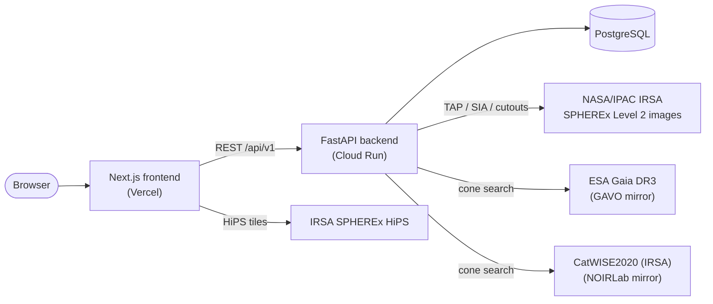

<p align="center"></p>

# Nebo — SPHEREx sky viewer

Nebo is a web viewer of the infrared sky built for the **NASA Space Apps Challenge 2026,
"Planet X and SPHEREx"**. It lets anyone fly over the whole sky as seen by NASA's SPHEREx
mission, zoom into any field and **blink between observation epochs** to spot what changed:
stars that move, objects that vary, and candidate signals worth a closer look.

> Nebo shows *observed changes* and *candidate signals*. It never claims a discovery
> ("Planet X found"). Catalogued objects are kept apart from uncatalogued movements, and
> anything simulated is labelled as such.

## The challenge

SPHEREx maps the entire sky in 102 infrared colours (0.75–5 µm) and revisits it about every six
months. Comparing those visits is how faint, cold, nearby objects (brown dwarfs, or a
hypothetical distant planet) give themselves away: they move against the background stars.
Earlier, the public found hundreds of such objects in NASA WISE data with tools like
[WiseView](http://byw.tools/wiseview). Nebo brings that blink-comparator idea to SPHEREx.

## What Nebo does

### Start and cockpit

- **Launch sequence.** A start screen inside the ship, still landed on Earth, with the menu on
  its wall screen (and a link to this repository); then the Nebo power-on and a hyperspace
  tunnel while the sky loads.
- **Sky explorer.** A cockpit over an all-sky SPHEREx map (Aladin Lite with IRSA's SPHEREx
  HiPS), with Sky map, Objects, Catalogs and Tools screens. Pick a featured destination, type
  RA/Dec or move the map; zoom, jump back to the whole sky, and toggle the Nebo object
  markers, the landmarks (famous infrared sights and the Sun's nearest neighbours) and the
  coordinate grid. A marker under the centre crosshair or the pointer shows its name; clicking it
  pins the name and makes it the
  destination (a second click drops it). The console shows the map centre, the
  nearest catalogued object, the field of view and the UTC clock.
- **Guided tour.** A step-by-step tutorial over annotated screenshots of the real interface.

### Field viewer

- **Real SPHEREx images per epoch.** For any position and detector (D1–D6 = six wavelength
  bands) and a 3′, 6′ or 15′ field, the backend fetches the real SPHEREx images from NASA/IPAC
  IRSA, groups them into epochs, co-adds them and renders one image per epoch on a common grid
  (north up, east left, 6.15″/px) with a shared stretch, so the differences you see are real.
- **Fast first look.** Coordinate searches build in steps (archive search, download, first
  image, one image per epoch, refinement) with visible progress: a first image in tens of
  seconds, all epochs soon after (already blinkable as a preview, with Gaia and CatWISE
  prefetched), refined images when the build ends.
- **Blink comparator and stack.** Step through the epochs with the date strip, buttons or
  arrow keys, or blink them at 0.4, 0.8 or 1.5 s per frame. The stack view co-adds the epochs
  you choose (inverse-variance) to reveal fainter sources.
- **Catalog layers.** ESA Gaia DR3 stars propagated to each epoch, CatWISE sources, detected
  changes and the bad-pixel mask, to tell catalogued stars from uncatalogued movers; plus an
  alignment check and per-epoch data-quality notes.
- **Object panel and suggestions.** Name, type, band, instrument and image count of the
  selected object, and suggested destinations (flagged when they need a fresh 1–3 min download).
- **Shareable links.** Copy a link that reopens the same field, size and epoch.
- **Object hologram.** A spinning 3D model of the observed object, captioned as an artist's
  impression, not SPHEREx data.

### Scientific analysis

- **Compare (3-panel).** Two epochs and their difference image.
- **RGB composite.** Any three detectors as colour channels, with presets (cold dust and brown
  dwarfs, ices and gas, near-IR stars).
- **Spectrum.** The spectrum measured from the field's exposures (local sky subtracted, blends
  and saturated exposures set apart), and its 102 SPHEREx channels with molecular lines (H₂O,
  CH₄, CO₂, CO…) and a template fit that says when no template matches.
- **Models and metrics.** Event and spectrum classifiers and a temporal forecast, all run on the
  field's own measurements: the epoch difference and centroid shift, a light curve corrected for
  the filter's wavelength sweep, the measured spectrum. A part that cannot be measured (e.g. a
  saturated star) says why. Plus saturation checks and community votes (real change, moving
  object, artifact, uncertain).

### Community

- **Chat.** A public chat room per object (a general room otherwise); messages are filtered
  and deleted after 24 h.

### Honest by design

- **Honest labels.** Observation dates and data releases (e.g. DR1, QR3) come from the archive;
  model outputs are computed from the field's own data and say "model estimate, not a
  detection"; what cannot be measured is said, never filled in.

Featured targets: Barnard's Star, ε Indi B, WISE 0855−0714 (visible only in detector 6),
RW Aurigae and R Draconis.

## How Nebo meets the judging criteria

Space Apps judges every project, at the local event and at the global final, on the same five
criteria. This is how Nebo answers each one.

### Impact

*Does it solve a real problem with a tangible benefit?*

- **The problem:** SPHEREx data is public, but reaching it takes archive queries (TAP, SIA),
  FITS files, alignment and Python. Comparing two visits of the same patch of sky is out of
  reach for almost everyone.
- **The benefit:** Nebo turns any sky position into aligned, blinkable epochs in a browser, with
  nothing to install, and shows a first image in tens of seconds.
- **Who it helps:** students, teachers, amateur astronomers and researchers. Public blinking of
  NASA WISE data (WiseView, Backyard Worlds) has already found hundreds of brown dwarfs; Nebo
  opens the same door for SPHEREx.
- **A review pool, not just a viewer:** community votes (real change, moving object, artifact,
  uncertain) and a chat room per object let many eyes check each candidate.

### Creativity

*How original and fresh is the approach?*

- **A new tool for a new mission:** the blink comparator idea, rebuilt for SPHEREx and its
  six detectors.
- **A journey, not a form:** from the ship on Earth, through power-on and a hyperspace tunnel,
  to the cockpit and the observation room. The animation accompanies the science and never
  covers it.
- **Beyond blinking:** RGB composites of SPHEREx detectors, measured spectra, difference images
  and a 3D hologram of each object (clearly labelled as an artist's impression).

### Validity

*Is it scientifically and technically sound?*

- **Real data, handled carefully:** every image comes from NASA/IPAC IRSA. Epochs are rendered
  on a common grid (north up, east left, 6.15″/px) with one shared stretch per field size, so
  the differences you see are real. Detectors are never mixed in a comparison.
- **Catalogued vs uncatalogued:** Gaia DR3 stars propagated to each epoch and CatWISE sources
  separate known objects from uncatalogued movements; the bad-pixel mask, saturation and
  alignment checks flag artifacts.
- **Honest output:** observation dates and data releases come from the archive, model outputs
  are computed from each field's measurements (or say why they cannot be), and Nebo only ever
  speaks of *observed changes* and *candidate signals*.
- **Solid engineering:** a FastAPI + PostgreSQL backend that builds fields in stages (`202` with
  progress, then `200`), deployed on Google Cloud Run and Vercel, and covered by 330+ automated
  tests (221 backend, 115 frontend) plus a Playwright browser journey.

### Relevance

*Does it answer the chosen challenge directly?*

- The challenge, "Planet X and SPHEREx", asks how to find faint objects that move between
  SPHEREx visits. That is Nebo's core loop: pick a field, split it into epochs, blink, and check
  whatever moves against Gaia and CatWISE.
- The featured targets are real nearby movers that prove the method works: Barnard's Star,
  ε Indi B and WISE 0855−0714, the coldest known brown dwarf, visible only in detector 6.

### Presentation

*Is the idea easy to grasp and exciting in 30 seconds / 7 slides?*

- **One sentence:** "Blink the infrared sky: Nebo lets anyone watch SPHEREx catch things
  moving."
- **A 30-second demo:** launch → warp → choose WISE 0855−0714 → detector 6 → blink → the dot
  moves.
- **Seven slides:** problem, challenge, Nebo, live demo, the science behind it, honest limits,
  what comes next.
- **Self-explaining:** an in-app guided tour walks first-time users through every control.

### Why Nebo

Nebo is a working product on real SPHEREx data, not a mock-up. It puts the science first and
tells the truth about what it shows, it is built for anyone from a curious student to a
professional astronomer, and it grows with SPHEREx: every new visit of the sky adds an epoch to
blink.

## Architecture at a glance



The full picture (deployment, build pipeline, database ER diagram, component tree, user
journey, request sequence) is in **[docs/architecture.md](docs/architecture.md)**. Every
external data source is listed in **[docs/data-sources.md](docs/data-sources.md)**. The physics,
constants, metrics and techniques are in
**[docs/science-and-techniques.md](docs/science-and-techniques.md)**.

## Repository layout

| Folder | What it is |
| --- | --- |
| [`backend/`](backend/) | FastAPI + PostgreSQL API and ETL. API contract in [`backend/README.md`](backend/README.md) |
| [`frontend/`](frontend/) | Next.js app: menu, sky explorer and field viewer. See [`frontend/README.md`](frontend/README.md) |
| [`shared/`](shared/) | Synthetic static demo export with the same shape as the API |
| [`docs/`](docs/) | Architecture, data sources, science and techniques, frontend plan, lab notes |
| `data/` | Placeholder; raw data is never committed |
| `artifacts/` | Design and verification artifacts |

## Quick start

**Backend** (Python 3.12):

```bash
docker compose up -d postgres                 # local PostgreSQL 16
cd backend
python -m venv .venv && source .venv/bin/activate
pip install -r requirements-dev.txt
cp .env.example .env                          # set DATABASE_URL
python -m app.db init                         # tables + catalogue (idempotent)
uvicorn app.main:app --reload                 # http://127.0.0.1:8000/docs
pytest                                        # no network or DB needed
```

Optional preload of the featured targets (about 50 min): `python -m app.etl run`.

**Frontend** (Node.js 20.9+):

```bash
cd frontend
npm ci
npm run dev                                   # http://localhost:3000
npm test && npm run typecheck
```

The frontend expects the API at `http://127.0.0.1:8000`; set `NEXT_PUBLIC_API_ORIGIN` in
`frontend/.env.local` to change it.

## Deployment

Frontend on Vercel; backend image (`backend/Dockerfile`) on Google Cloud Run with
`NEBO_BUILD_MODE=queue`, a separate `python -m app.etl worker`, `NEBO_DISK_CACHE=0` and an
optional GCS bucket for cutouts. Details in [docs/architecture.md §2](docs/architecture.md#2-deployment-and-processes).

## Data and resources

| Resource | Use in Nebo |
| --- | --- |
| [NASA/IPAC Infrared Science Archive: SPHEREx](https://irsa.ipac.caltech.edu/Missions/spherex.html) | All science images (TAP, SIA, cutouts) and the all-sky HiPS map |
| [IRSA SPHEREx tutorial notebooks](https://caltech-ipac.github.io/irsa-tutorials/) | Reference for data access from Python |
| [WiseView](http://byw.tools/wiseview) | Inspiration for the blink comparator |
| [ESA Gaia Data Release 3](https://www.cosmos.esa.int/web/gaia/dr3) | Catalogued-star overlay (ESA archive, GAVO mirror as fallback) |
| [CatWISE2020](https://catwise.github.io/) (IRSA) | Infrared source overlay and cold-candidate check (NOIRLab Astro Data Lab mirror as fallback) |
| [SIMBAD](https://simbad.cds.unistra.fr/) | Fixed coordinates of the featured targets and of the sky-map landmarks (not queried at run time) |
| CSA [NEOSSat](https://www.asc-csa.gc.ca/eng/satellites/neossat/) and [CADC](https://www.cadc-ccda.hia-iha.nrc-cnrc.gc.ca/) | Listed by the challenge; not used yet |

## Contributing

Read [`AGENTS.md`](AGENTS.md) (humans and AI agents alike). In short: small commits with
Conventional Commits, tests for new logic, all code and UI text in English, and **every change
that alters how the system works also updates `docs/architecture.md` and, if data sources
change, `docs/data-sources.md`**.

## Credits

SPHEREx data courtesy of NASA/JPL-Caltech and the NASA/IPAC Infrared Science Archive. Gaia data
from the European Space Agency mission Gaia, processed by the Gaia DPAC. CatWISE2020 is based on
data from NASA's WISE and NEOWISE missions. This project has made use of the SIMBAD database,
operated at CDS, Strasbourg, France. NASA does not endorse
any non-U.S. Government entity and is not responsible for information contained on
non-U.S. Government websites.
