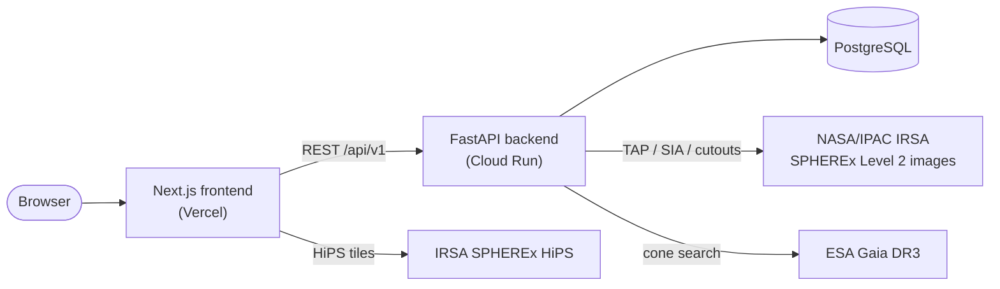

# Nebo — SPHEREx sky viewer

Nebo is a web viewer of the infrared sky built for the **NASA Space Apps Challenge 2026,
"Planet X and SPHEREx"**. It lets anyone fly over the whole sky as seen by NASA's SPHEREx
mission, zoom into any field and **blink between observation epochs** to spot what changed:
stars that move, objects that vary, and candidate signals worth a closer look.

> Nebo shows *observed changes* and *candidate signals*. It never claims a discovery
> ("Planet X found"). Catalogued objects are kept apart from uncatalogued movements, and
> anything simulated is labelled as such.

## The challenge

SPHEREx maps the entire sky in 102 infrared colours (0.75–5 µm) and revisits it about every six
months. Comparing those visits is how faint, cold, nearby objects (brown dwarfs, or a
hypothetical distant planet) give themselves away: they move against the background stars.
Earlier, the public found hundreds of such objects in NASA WISE data with tools like
[WiseView](http://byw.tools/wiseview). Nebo brings that blink-comparator idea to SPHEREx.

## What Nebo does

- **Sky explorer.** A cockpit over an all-sky SPHEREx map (Aladin Lite with IRSA's SPHEREx
  HiPS). Fly to featured targets or type RA/Dec.
- **Field viewer and blink comparator.** For any position and detector (D1–D6 = six
  wavelength bands), the backend fetches the real SPHEREx images from NASA/IPAC IRSA, groups
  them into epochs, co-adds them and renders one image per epoch on a common grid (north up,
  east left, 6.15″/px) with a shared stretch, so the differences you see are real.
- **Fast first look.** Coordinate searches build in steps: a first image in tens of seconds,
  all epochs soon after, refined images when the build ends.
- **Gaia overlay.** ESA Gaia DR3 stars, propagated to each epoch, to tell catalogued stars
  from uncatalogued movers.
- **Observation lab** (`/lab/observation`). Pan/zoom across 3′/6′/15′ fields, expected-position
  marker for known movers, Gaia rings, and an offline simulated demo.
- **Honest labels.** Observation dates and data releases (e.g. DR1, QR3) come from the archive;
  science-model outputs that are still simulated say so.

Featured targets: Barnard's Star, ε Indi B, WISE 0855−0714 (visible only in detector 6),
RW Aurigae and R Draconis.

## Architecture at a glance



The full picture (deployment, build pipeline, database ER diagram, component tree, user
journey, request sequence) is in **[docs/architecture.md](docs/architecture.md)**. Every
external data source is listed in **[docs/data-sources.md](docs/data-sources.md)**.

## Repository layout

| Folder | What it is |
| --- | --- |
| [`backend/`](backend/) | FastAPI + PostgreSQL API and ETL. API contract in [`backend/README.md`](backend/README.md) |
| [`frontend/`](frontend/) | Next.js app: menu, sky explorer, field viewer, observation lab. See [`frontend/README.md`](frontend/README.md) |
| [`shared/`](shared/) | Synthetic static demo export with the same shape as the API |
| [`docs/`](docs/) | Architecture, data sources, frontend plan, lab notes |
| `data/` | Placeholder; raw data is never committed |
| `artifacts/` | Design and verification artifacts |

## Quick start

**Backend** (Python 3.12):

```bash
docker compose up -d postgres                 # local PostgreSQL 16
cd backend
python -m venv .venv && source .venv/bin/activate
pip install -r requirements-dev.txt
cp .env.example .env                          # set DATABASE_URL
python -m app.db init                         # tables + catalogue (idempotent)
uvicorn app.main:app --reload                 # http://127.0.0.1:8000/docs
pytest                                        # no network or DB needed
```

Optional preload of the featured targets (about 50 min): `python -m app.etl run`.

**Frontend** (Node.js 20.9+):

```bash
cd frontend
npm ci
npm run dev                                   # http://localhost:3000
npm test && npm run typecheck
```

The frontend expects the API at `http://127.0.0.1:8000`; set `NEXT_PUBLIC_API_ORIGIN` in
`frontend/.env.local` to change it.

## Deployment

Frontend on Vercel; backend image (`backend/Dockerfile`) on Google Cloud Run with
`NEBO_BUILD_MODE=queue`, a separate `python -m app.etl worker`, `NEBO_DISK_CACHE=0` and an
optional GCS bucket for cutouts. Details in [docs/architecture.md §2](docs/architecture.md#2-deployment-and-processes).

## Data and resources

| Resource | Use in Nebo |
| --- | --- |
| [NASA/IPAC Infrared Science Archive: SPHEREx](https://irsa.ipac.caltech.edu/Missions/spherex.html) | All science images (TAP, SIA, cutouts) and the all-sky HiPS map |
| [IRSA SPHEREx tutorial notebooks](https://caltech-ipac.github.io/irsa-tutorials/) | Reference for data access from Python |
| [WiseView](http://byw.tools/wiseview) | Inspiration for the blink comparator |
| [ESA Gaia Data Release 3](https://www.cosmos.esa.int/web/gaia/dr3) | Catalogued-star overlay |
| CSA [NEOSSat](https://www.asc-csa.gc.ca/eng/satellites/neossat/) and [CADC](https://www.cadc-ccda.hia-iha.nrc-cnrc.gc.ca/) | Listed by the challenge; not used yet |

## Contributing

Read [`AGENTS.md`](AGENTS.md) (humans and AI agents alike). In short: small commits with
Conventional Commits, tests for new logic, all code and UI text in English, and **every change
that alters how the system works also updates `docs/architecture.md` and, if data sources
change, `docs/data-sources.md`**.

## Credits

SPHEREx data courtesy of NASA/JPL-Caltech and the NASA/IPAC Infrared Science Archive. Gaia data
from the European Space Agency mission Gaia, processed by the Gaia DPAC. NASA does not endorse
any non-U.S. Government entity and is not responsible for information contained on
non-U.S. Government websites.
