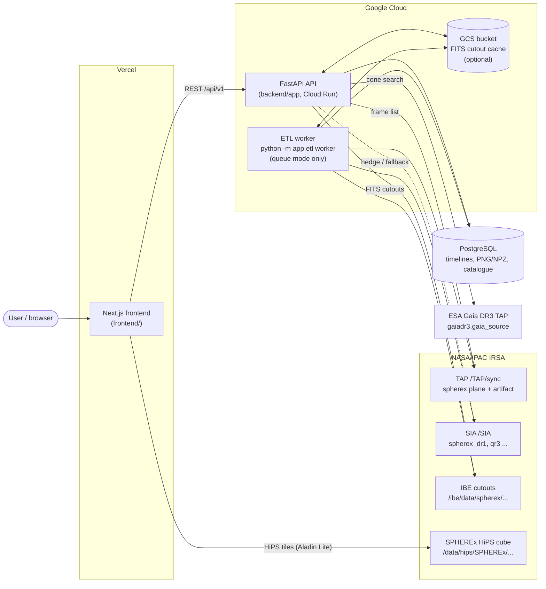
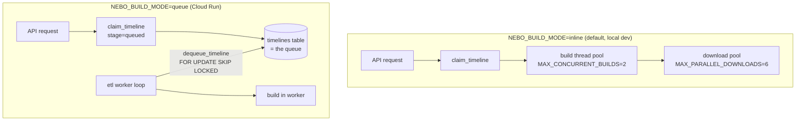
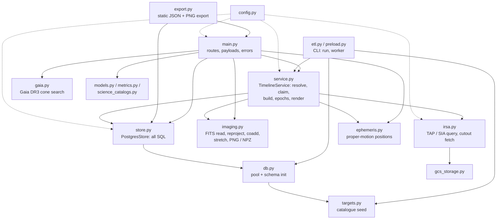
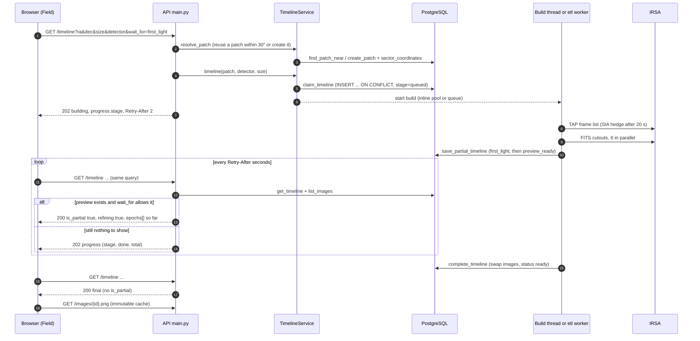
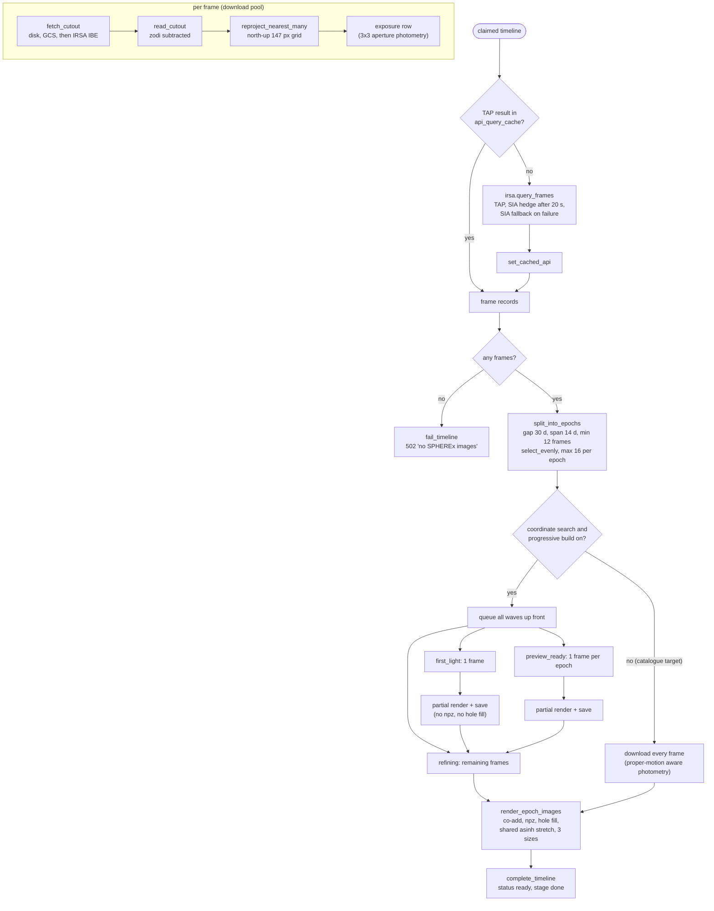
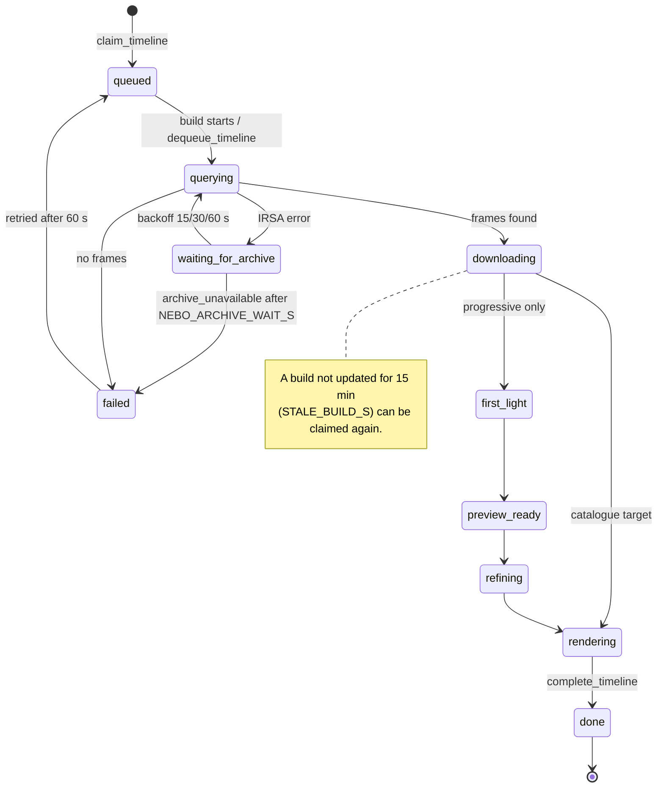
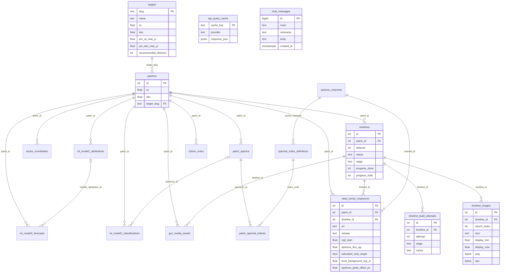
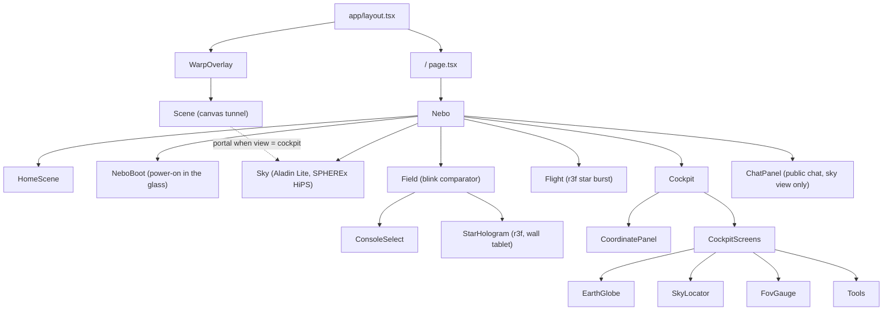
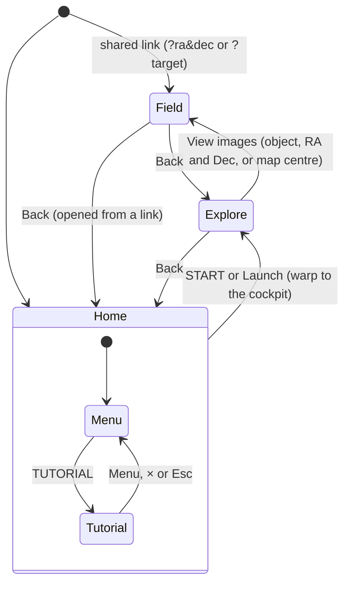
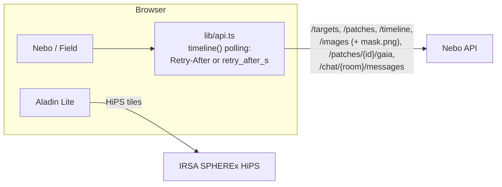

# Nebo architecture

How the system works today, end to end: deployment, backend, database, frontend and the
external data it uses. Every diagram is Mermaid, so GitHub renders it in place.

> **Keep this file true.** When a change touches an endpoint, a table, a build step, a data
> source, a deploy setting, an environment variable or the user journey, update the matching
> section and diagram here and add a line to the [changelog](#architecture-changelog). The
> checklist is in [`AGENTS.md`](../AGENTS.md#keeping-docs-in-sync). External data sources are
> detailed in [`data-sources.md`](data-sources.md). The numbers, formulas and techniques behind
> each step (pixel scale, stretch, photometry, change thresholds, retries, zoom) are in
> [`science-and-techniques.md`](science-and-techniques.md).

Contents:
[1. System context](#1-system-context) ·
[2. Deployment and processes](#2-deployment-and-processes) ·
[3. Backend](#3-backend) ·
[4. Timeline request flow](#4-timeline-request-flow) ·
[5. Build pipeline](#5-build-pipeline) ·
[6. Database](#6-database) ·
[7. Caches and storage](#7-caches-and-storage) ·
[8. Frontend](#8-frontend) ·
[9. Real vs simulated data](#9-real-vs-simulated-data) ·
[10. Known gaps and doc drift](#10-known-gaps-and-doc-drift) ·
[Science and techniques](science-and-techniques.md) ·
[Changelog](#architecture-changelog)

---

## 1. System context

Nebo is a web viewer of the infrared sky. The user flies over an all-sky SPHEREx map, picks a
target, types coordinates or just centres the map, and opens a small field where the SPHEREx images of each epoch
can be blinked to spot real changes (movers, variables).

- The browser talks to **our API** for everything except the background sky map, which
  Aladin Lite streams straight from IRSA's SPHEREx HiPS.
- The API never proxies HiPS tiles and never stores raw FITS in Postgres: it stores the
  processed PNG/NPZ per epoch and the metadata of every exposure used.

## 2. Deployment and processes

| Piece | Where | How it starts |
| --- | --- | --- |
| Frontend | Vercel (default Next.js settings, `next build --webpack`) | `NEXT_PUBLIC_API_ORIGIN` points at the API |
| API | Cloud Run, from `backend/Dockerfile` (python:3.12-slim, port 8080) | `python -m app.db init \|\| true; uvicorn app.main:app` |
| ETL worker | Same image, command `python -m app.etl worker` | Only when `NEBO_BUILD_MODE=queue` |
| Preload / batch ETL | Same image or a laptop | `python -m app.etl run` (alias `python -m app.preload`) |
| PostgreSQL | Managed Postgres in the cloud; `docker-compose.yml` runs Postgres 16 locally | `backend/db/schema.sql` is applied by `app.db init` |
| GCS | Optional bucket, enabled by `NEBO_GCS_BUCKET` | Read before IRSA, written after a download |

Cloud Run throttles CPU once a response is sent, so builds started inside the API stall
there; that is why the cloud uses queue mode plus a worker. Set `NEBO_DISK_CACHE=0` on Cloud
Run (its disk lives in RAM).

**Environment variables** (backend `app/config.py`, `app/gcs_storage.py`):

| Variable | Default | Effect |
| --- | --- | --- |
| `DATABASE_URL` | empty | Postgres DSN; empty means the API answers 503 |
| `NEBO_BUILD_MODE` | `inline` | `inline` builds in the API, `queue` leaves it to `etl worker` |
| `NEBO_MAX_PARALLEL_DOWNLOADS` | 6 | Cutout downloads in flight per process |
| `NEBO_MAX_CONCURRENT_BUILDS` | 2 | Builds running at once (inline) |
| `NEBO_MAX_PENDING_BUILDS` | 6 | Beyond this, new patches get 503 busy (inline) |
| `NEBO_HTTP_TIMEOUT_S` | 180 | Cutout download timeout |
| `NEBO_DISK_CACHE` / `NEBO_CACHE_DIR` | `1` / `backend/.cache` | FITS cache on disk |
| `NEBO_PROGRESSIVE_COORDINATE_BUILD` | `1` | Wave-by-wave builds for coordinate searches |
| `NEBO_CORS_ORIGINS` | `*` | Allowed frontend origins |
| `NEBO_GCS_BUCKET` / `NEBO_GCS_PROJECT` / `NEBO_GCS_PREFIX` | unset | Optional GCS cutout cache |
| `NEXT_PUBLIC_API_ORIGIN` (frontend) | `http://127.0.0.1:8000` | API base URL seen by the browser |

## 3. Backend

FastAPI + psycopg 3 + NumPy/Astropy. The full API contract is in
[`backend/README.md`](../backend/README.md).

| Module | Responsibility |
| --- | --- |
| `main.py` | FastAPI app, CORS, error handlers (503 no DB / busy), payload builders, every route |
| `service.py` | `TimelineService`: patch resolution (30″ reuse), atomic claim, build orchestration, epoch splitting, progressive waves, rendering |
| `irsa.py` | IRSA access: TAP query (SIA hedge after 20 s, SIA fallback on failure), cutout URL, cutout download with disk/GCS cache and backoff |
| `imaging.py` | Reads IMAGE/VARIANCE/FLAGS/ZODI, subtracts zodi, north-up TAN grid, nearest-neighbour reprojection, inverse-variance co-add, asinh stretch, PNG/NPZ, diff PNG |
| `store.py` | `PostgresStore` (connection pool 1–10) with all SQL; `Store` protocol used by tests |
| `db.py` | Process-wide store; `python -m app.db init` applies the schema and seeds targets, 102 channels and 17 indices |
| `gaia.py` | ESA Gaia DR3 cone search (CSV), position propagation from J2016.0 |
| `ephemeris.py` | Expected position from proper motion (catalogue epoch 2026.2) |
| `real_science.py`, `models.py`, `metrics.py`, `science_catalogs.py` | Science layer: measured spectrum, light curve and Model 1 features (`real_science`), photometry, spectral indices, Models 1–3. Measured on each patch; see [section 9](#9-real-vs-simulated-data) |
| `etl.py`, `preload.py` | Batch builds (`run`) and the queue worker (`worker`) |
| `export.py` | Exports ready timelines as static JSON + PNG with the same shape as the API |
| `targets.py` | Seed catalogue: Barnard's Star, ε Indi B, WISE 0855, RW Aurigae, R Draconis |

### Endpoints (`/api/v1`)

| Group | Endpoints |
| --- | --- |
| Health and catalogue | `GET /health`, `GET /targets`, `GET /patches`, `GET /catalogs/channels`, `GET /catalogs/spectral-indices` |
| Images and timelines | `GET /timeline`, `GET /timeline/diff`, `GET /timeline/stack`, `GET /timeline/rgb`, `GET /images/{id}.png`, `GET /images/{id}.npz`, `GET /images/{id}/mask.png`, `GET /patches/{id}/sectors` |
| Gaia | `GET /patches/{id}/gaia` |
| Science (measured) | `GET /patches/{id}/spectrum`, `GET /patches/{id}/metrics`, `POST /patches/{id}/analyze` |
| Models (on measured data; demo only for a `scenario`) | `POST /models/classify-event`, `POST /models/classify-spectrum`, `POST /models/forecast-temporal`, `GET /patches/{id}/models/{event,spectrum,forecast}` |
| Citizen votes | `POST /patches/{id}/votes`, `GET /patches/{id}/votes` |
| Public chat | `GET /chat/{room}/messages?after=`, `POST /chat/{room}/messages` (room = target slug or `general`) |

Status codes on `/timeline`: `200` ready, `202` building (`Retry-After` 2 s early, 5 s later),
`502` failed (retried after 60 s), `503` no database or too many builds, `404` unknown target.

## 4. Timeline request flow

`GET /timeline?ra&dec|target&size&detector[&wait_for]` is the heart of the app. It never blocks:
the first call claims a build and returns `202`, the client polls.

Notes:
- `wait_for=first_light|preview` is opt-in and only for coordinate searches; the default
  (`complete`) keeps answering `202` until the build ends.
- The web frontend uses the default and renders the `epochs[]` already present in each `202`
  as a "Preview" (with the build steps and a progress bar) and keeps epoch comparison locked
  until the final `200`, so a new coordinate shows its first image at first light.
- Partial saves replace the image rows, so **image ids change**: clients re-read
  `image_url` on every poll.
- All epochs of one size share `display_min/max`, so a blink compares like with like.

## 5. Build pipeline

Sizes: the cutout is always fetched at 0.25° × √2 and reprojected onto the large grid
(147 px at 6.15″/px); medium (59 px) and small (31 px) are central crops. North is up, east is
left, and the patch centre is the central pixel.

## 6. Database

PostgreSQL, schema in [`backend/db/schema.sql`](../backend/db/schema.sql) (idempotent; applied by
`python -m app.db init`). PNG and NPZ bytes live in `timeline_images` as `bytea`.

| Table | What it holds | Written by | Read by |
| --- | --- | --- | --- |
| `targets` | Seed catalogue with proper motions | `db init`, `etl` (`upsert_targets`) | `/targets`, builds (proper motion) |
| `patches` | One per sky position (reused within 30″) | `create_patch` | everything patch-scoped |
| `timelines` | One per patch × detector: status, stage, progress; doubles as the build queue | claim, progress, partial/complete/fail | `/timeline`, `/patches`, worker |
| `timeline_images` | PNG per epoch × size, NPZ for the large size | partial and final saves | `/timeline`, `/images`, `/timeline/diff`, `/timeline/stack`, `/metrics` |
| `sector_coordinates` | Corners and bounds of each size and the fetch size | `create_patch` | `/patches/{id}/sectors` |
| `nasa_sector_exposures` | Every IRSA exposure used: uri, release, times, WCS, photometry, cutout URL | builds | epoch `releases`, `coverage`, `quality` and `warnings`, `/sectors` |
| `api_query_cache` | IRSA TAP frame lists (`irsa_spherex_tap`) and Gaia cones (`gaia_dr3_tap`) | builds, `/gaia` | builds, `/gaia` |
| `spherex_channels`, `spectral_index_definitions` | 102 channels and 17 spectral indices | `db init` | `/catalogs/*`, science |
| `patch_spectra`, `patch_spectral_indices` | Per-patch spectra and indices of the old simulated path (the measured spectrum is recomputed from the exposures, not stored) | `scenario` analyses | nothing on the default path |
| `ml_model1_attributions`, `ml_model2_classifications`, `ml_model3_forecasts` | Model outputs: `v2-measured` (measured) and `v1` (old simulated rows, ignored) | model endpoints | model endpoints |
| `citizen_votes` | Votes per epoch (`REAL_CHANGE`, `ARTIFACT`, `MOVER`, `UNSURE`) | `POST /votes` | `GET /votes` (token hidden) |
| `gcs_media_assets` | Planned registry of GCS objects | **never written** | **never read** |
| `chat_messages` | Public chat, one room per target plus `general`; no foreign keys, rows older than 24 h are deleted | `POST /chat/{room}/messages` (also purges) | `GET /chat/{room}/messages` |

## 7. Caches and storage

| Layer | Key | Where | Notes |
| --- | --- | --- | --- |
| Patch reuse | position within 30″ | `patches` | Nearby searches share all caches below |
| TAP frame list | sha256 of patch ra/dec + detector | `api_query_cache` | No expiry; skipped on `--rebuild` |
| Gaia cone | patch ra/dec + cone radius + `g_max` + row limit | `api_query_cache` | One cone covers every size |
| FITS cutout (disk) | sha256 of the cutout URL | `NEBO_CACHE_DIR/cutouts/` | Off with `NEBO_DISK_CACHE=0` |
| FITS cutout (GCS) | same, under `NEBO_GCS_PREFIX/cutouts/` | GCS bucket | Read before IRSA, written after |
| Processed images | image id | `timeline_images` | Served with `Cache-Control: immutable` |

## 8. Frontend

Next.js 16 (App Router) + TypeScript + React 19, Aladin Lite 3 for the sky, GSAP for camera
and menu motion, react-three-fiber for the star burst, d3-geo for the cockpit globe, CSS
modules + Tailwind 4. Setup in [`frontend/README.md`](../frontend/README.md).

### Routes

| Route | File | What it is |
| --- | --- | --- |
| `/` | `app/page.tsx` → `components/Nebo.tsx` | The whole app: menu, sky explorer, field viewer, switched by state |

`app/layout.tsx` keeps `WarpOverlay` mounted for the whole session. `lib/lab/` keeps only
`gaia.ts`, `sky.ts`, `fov.ts` and `viewport.ts`, used by the field viewer (the lab route that
once owned them was removed).

### Component tree

| Component | Role |
| --- | --- |
| `Nebo` | Root state machine (`view`: Home, Explore, Field), loads `/targets`, orchestrates the GSAP camera turns and the warp |
| `HomeScene` | Start screen inside the landed ship: menu (START, TUTORIAL) and falling leaves in the forest window |
| `TutorialTour` | Full-screen guided tutorial opened from TUTORIAL: 5 steps, each a screenshot of a section (`public/tutorial/*.webp`) with numbered callouts and leader lines |
| `Sky` | Aladin Lite map, SPHEREx HiPS cube (AIT projection), target markers, executes camera commands |
| `Cockpit`, `CockpitScreens`, `CoordinatePanel` | Console over the sky: destinations, RA/Dec entry, zoom, layers, Earth sub-point globe, clock |
| `Field` | Observation console: detector and size selectors, timeline polling, epoch preload, blink playback, difference view, epoch stack (`/timeline/stack`) |
| `WarpOverlay` | Tunnel transition that ends when the destination is ready (max 12 s) |
| `Flight` | Short WebGL2 star burst (desktop only) |
| `NeboBoot` | Nebo power-on played in the cockpit glass after START (3.2 s), before the approach tunnel; the app is `inert` from START until the tunnel ends |
| `StarHologram` | Spinning 3D model of the observed object on the field room's wall tablet (procedural shader; colours from each object's temperature; wide screens only) |
| `ChatPanel` | Public chat key (top-left) and panel in the sky explorer: room = selected target or `general`, polls every 3 s while open, generated nickname in `localStorage` |

### User journey

Reduced motion (`prefers-reduced-motion`) skips every animation, including the leaves. The blink
speed is set in the field console. Destinations come only from the cockpit (Objects tab or the
RA/Dec panel); the older menu screens (Observe, Featured objects, coordinate form, Settings) were
removed.

### Data flow

- One environment variable: `NEXT_PUBLIC_API_ORIGIN`.
- `timeline()` handles `202` by waiting `Retry-After` (or `retry_after_s`, default 5 s) and
  shows `progress.stage`; errors carry their own retry countdown.
- The app has no demo fallback: without the API it shows an error (the lab that could switch to
  the synthetic demo was removed).
- Gaia is never queried from the browser; it goes through `/patches/{id}/gaia`.

### Tests

- Frontend unit tests: `npm test` (`tsx --test tests/*.test.ts`): api, coordinates, fov,
  viewport, sky, gaia, warp, demo palettes.
- Browser flows: Playwright scripts in `frontend/tests/*.mjs`, run by hand against a local build.
- Backend: `pytest` in `backend/` (no network or DB needed; Postgres tests run only with
  `NEBO_TEST_DATABASE_URL`).

## 9. Real vs simulated data

Part of the project's honest-science rule: the UI must say "observed change" or "candidate
signal", never "Planet X found".

| Output | Source |
| --- | --- |
| Epoch images (PNG/NPZ), dates, releases, exposure metadata | **Real**: IRSA SPHEREx Level 2 images |
| Exposure photometry, `image_photometry` in `/metrics` | **Real**: measured on the real images |
| Gaia overlay | **Real**: ESA Gaia DR3 |
| Background sky map | **Real**: IRSA SPHEREx HiPS |
| Spectrum, spectral indices, light curve, variability, confidence, Models 1–3 | **Measured** on each patch (`real_science.py`); a part that cannot be measured says why (`available: false`). Demo profiles only for an explicit `scenario` (`simulated: true`) |
| Model 1–3 logic | Hand-tuned estimators (not trained), shown as "model estimate, not a detection"; Model 2's templates rarely fit real spectra, so a poor fit is said |
| `shared/demo*` | **Synthetic** (fake cutouts), kept as data; no route serves it now |
| Cockpit decorative stars, landscape art | Decorative, separate from detections |
| 3D model on the field room's tablet (`StarHologram`) | **Illustration** built from the object's type and temperature, captioned "Illustration" |

## 10. Known gaps and doc drift

Found while writing this document (2026-11-15); fix them and strike them here.

- `Field.tsx` maps only `queued`, `querying`, `downloading`, `rendering`; the stages
  `first_light`, `preview_ready`, `refining` fall back to a generic label, and the frontend does
  not use `wait_for` yet, so users wait for the full build before seeing an image.
- `gcs_media_assets` and `timeline_images.gcs_uri` are never written (`targets.gaia_*`,
  `targets.wise_*`, `patches.gaia_crossmatch_json`, and `patches.wise_crossmatch_json` are now
  populated by `app.db sync-catalogs` and `analyze_patch_science` / `classify_event`).
- Queue mode has no backpressure, and a worker killed mid-build leaves the timeline in a
  non-`queued` stage that the worker does not pick up again (only a new request after 15 min
  re-claims it).

## Architecture changelog

Newest first. One line per change that affects this document.

- **2026-11-15** — The Gaia/CatWISE cross-match for Model 1 is requested only when the field has an
  event to classify: fields without one answered in ~32 s per panel request while ESA Gaia and
  IRSA's CatWISE were down (every request retried the cross-match); now they answer without it.
- **2026-11-15** — `timeline_images.updated_at` (`ADD COLUMN IF NOT EXISTS`, set on every upsert):
  image rows now keep their id across partial and final saves, so `/timeline` versions
  `image_url`, `npz_url` and `mask_url` with `?v=`; without it a refined image kept the URL (and
  the year-long immutable cache) of its one-frame preview.
- **2026-11-15** — Consistency fixes: `store._replace_timeline_images_conn` now upserts by
  `(timeline_id, epoch_index, size)` instead of `DELETE + INSERT` (preserving image IDs across
  partial saves), `alignmentFor` uses `data.size.pixel_scale_arcsec`, `SpectrumChart` band edges
  match `irsa.DETECTOR_WAVELENGTH_RANGE_UM`, and `metrics.py` comments match the `6.5` px /
  `0.015` px² constants.

- **2026-11-15** — Real data for the science layer: new `app/real_science.py`. `/spectrum`,
  `/metrics`, `/models/{event,spectrum,forecast}` and the patch forms of the POST model endpoints
  now use the patch's own measurements (102-channel medians of the measured spectrum; a light
  curve fitted as channel flux x visit factor; Model 1 features from the normalised epoch
  difference, the P1-6 centroids and field-relative PSF shape) and answer `available: false` with
  a reason when a part cannot be measured. Model rows are stored as `v2-measured`; no schema
  change. Coordinate searches no longer borrow Barnard's Star's demo profile. Demo profiles only
  answer an explicit `scenario`. Validated on production data: Barnard, Eps Indi B and WISE 0855
  come out as movers (centroid shifts 1.73, 0.90 and 0.77 px), empty fields as "no event", and
  saturated stars without motion as not measurable.
- **2026-11-15** — `frontend/tests/browser.mjs` rewritten for the current journey (tutorial with 7
  steps, START → cockpit, Objects → View images → field with a 202, Back); it no longer expects the
  removed Observe menu.
- **2026-11-15** — Removed the URL-only observation lab: routes `/lab/observation` and
  `/lab/demo/[...path]`, `ObservationLab`, `ImageViewport`, `lib/lab/contract.ts` and
  `lib/lab/levels.ts`, and the warp's `viewer` destination. The field viewer's helpers in
  `lib/lab/` (Gaia, pixel↔sky, levels, viewport) stay. `shared/demo*` is kept as data.
- **2026-11-15** — P1-1 finished: `nasa_sector_exposures` gains `local_background_mjy_sr`,
  `local_background_sigma_mjy_sr`, `local_background_pixels` and `aperture_peak_offset_px`
  (`ADD COLUMN IF NOT EXISTS`, applied by `db init`). Builds fill them (clipped median of a 4–9 px
  annulus; where the light peaks in a 5×5 box); older rows by `python -m app.backfill_background`
  (re-reads the cutouts, batched, resumable). `/spectrum/measured` subtracts the sky, adds
  `background_subtracted`, `blended` points (≥ 1.2 px peak offset, left out of the median) and
  `excluded_no_background`. On real cutouts Eps Indi B now reaches ~0 at 0.76 µm (was ~1.2 mJy of
  sky); WISE 0855 is its own source only above ~4 µm (a neighbour ~1 px away below).
- **2026-11-15** — P1-5: `GET /timeline/stack?epochs=0,2` co-adds the chosen epochs (inverse
  variance, float32 arrays) into a PNG with the timeline's shared stretch; the field viewer has a
  "Stack" toggle with epoch chips. `/patches/{id}/candidates` now scales epoch B to A, matches the
  PSFs and smooths both by 1 px before the 5σ difference (default was 4σ), and labels residuals on
  static Gaia stars with consistent flux `catalogued_systematic`; it adds `counts`,
  `normalisation`, `snr_threshold` and `normalise=false` (raw difference). On Barnard's Star D3
  medium the raw 31–39 detections per epoch pair become 1–3 changes (Barnard's own dipole) plus
  10–15 likely systematics; the UI greys the latter out.
- **2026-11-15** — P1-6: offline target position validation. `python -m app.position_report`
  (read-only client of the public API: `/targets`, `/timeline` `expected_position`, epoch `.npz`)
  fits each catalogue target in every epoch and writes `docs/position-validation.md`. First run:
  29/29 detections within 1 px (worst 0.64 px, WISE 0855 D5, blended); 1 non-detection
  (WISE 0855 D6 epoch 1). No endpoint, table or pipeline change.
- **2026-11-15** — P1-3 flags and metadata per epoch: each `/timeline` epoch adds `quality`
  (frames used/available, mean clean and flagged pixel fraction and saturated frames, from the
  stored `nasa_sector_exposures` rows), `warnings` (`few_frames` < 4 frames, `dense_field`
  |b| < 10°, `saturation`, `mixed_bursts`) and `mask_url`; the timeline adds `galactic_b` and
  `ecliptic_beta` (astropy). New `GET /images/{id}/mask.png?size=` renders the NaN pixels of the
  epoch's float NPZ (cropped like the candidates) as an amber PNG, immutable by image id. The
  field viewer shows images used/available and the clean share under "This epoch", amber note
  chips from `warnings` (replacing the mixed-burst note), the latitudes in Coordinates, and a
  Mask layer switch. No schema change.
- **2026-11-15** — P1-1: `GET /patches/{id}/spectrum/measured` returns the spectrum measured from
  the stored exposures (one point per unsaturated exposure: λ at the object, 3×3 aperture flux in
  µJy, σ; plus the median per channel). The Spectrum tab shows it first, labelled Measured, above
  the illustrative model. No local background subtraction yet: valid for bright sources only.
- **2026-11-15** — Honest spectrum and epochs (P1-1, P1-4): while the spectrum is a model
  (`simulated`), the Spectrum tab is called "Spectrum (model)", reads "Illustrative model · not
  SPHEREx data" and hides Model 2's χ²red. Each `/timeline` epoch adds `coverage` (`span_days`
  over all frames; `max_gap_days` and `wavelength_um` min/max over the frames used in the co-add,
  so the gap can exceed 30 d; and `mixed_bursts` when the epoch is
  longer than `EPOCH_MAX_SPAN_DAYS`, i.e. small spans were folded in); the viewer shows it under
  "This epoch" with an amber note when bursts are mixed. Epoch grouping itself is unchanged.
- **2026-11-15** — The address bar follows the view: the field viewer keeps its link (target or
  ra/dec, fov, det, epoch, name) up to date, and the sky explorer and start screen write the Coords
  destination as `?ra=&dec=&view=sky` (cleared without one). A `view=sky` link presets the
  destination instead of opening the viewer. View images opens the catalogued object under the
  centre mark (radius scales with the zoom, ≥ 3′). The Earth globe can no longer be dragged.
- **2026-11-15** — Docs: new [`science-and-techniques.md`](science-and-techniques.md) lists every
  constant, threshold, formula and technique with its purpose; linked from this file, the docs
  index, `data-sources.md`, `observation-lab.md`, the README and the `AGENTS.md` checklist.
- **2026-11-15** — Journey (P1-2): the field viewer overlays Gaia DR3, CatWISE2020 and detected
  changes (Known vs New badges), shows a detail card for the clicked source, an alignment check
  with a labelled simulated offset, and suggested destinations. Frontend only; it reuses
  `/patches/{id}/gaia|wise|candidates|alignment` and `/explore/suggested`. CatWISE: an IRSA answer
  that is not a CSV table is now an error (it used to be cached as zero sources), and an empty
  cached CatWISE list is ignored. Shared coordinate links accept an optional `name`. The
  frontend reads `/candidates` changes from `classification` (it used to read a missing `label`,
  so every change looked alike in the viewer and in the Analysis panel).
- **2026-11-15** — Slow IRSA (P0-7): the Field gives up after 3 min without images (automatic
  retries included) and offers Retry / Choose another object; a field being built says it is not
  preloaded and points to the 5 catalogued targets. `NEBO_ARCHIVE_WAIT_S` default 300 → 150 s.
  New table `timeline_build_attempts` logs every failed IRSA query and failed build with its cause.
  Stop stays client-side (the server build continues and is cached).
- **2026-11-15** — Coordinate requests within 30″ of a catalogue object's 1990–2027 track resolve to
  that object's patch. Typed catalogue coordinates of fast movers (WISE 0855 is 128″ from its
  2026.2 position) used to start a new download instead of opening the preloaded field.
- **2026-11-15** — Journey: a field opened by coordinates that lands on a catalogued object's patch
  (the 30″ reuse rule; `/timeline` returns `patch.target`) is named as that object in the viewer.
  A failed `/candidates` request no longer shows the generic 404 text "could not find this object".
- **2026-11-15** — Journey: a shared link `/?ra=&dec=` or `/?target=` (with optional `fov` 3/6/15,
  `det` 1–6, `epoch` 1-based) opens the field viewer directly; invalid links start at Home. The
  viewer's "Copy link" button writes that link. Parsing in `frontend/lib/fieldLink.ts`.
- **2026-11-15** — `/candidates` and `/alignment` crop the largest size's float32 arrays to the
  requested size (only `large` stores `.npz`); before, any other size always answered 404 and the
  UI showed it as "0 detected changes". The UI now says "unavailable" on a failed request.
  `/candidates` adds `truncated` (detection hit the 25 cap); the UI shows "25+".
- **2026-11-15** — Science API contract: `/patches/{id}/spectrum` adds a derived `channels[]`;
  the frontend types follow the backend names (`c_global`, `phi`, variability keys). Each science
  tab renders inside an error boundary.
- **2026-11-15** — Field: the science analysis tabs open in a slide-in side panel (Analysis
  pill on the image; full-screen sheet on narrow screens) instead of inline in the console grid;
  a field load can be stopped (polling stops, the server build continues and is cached), and the
  NASA retry stage explains that 2–4 attempts are normal.
- **2026-11-15** — IRSA outages: the build waits in `waiting_for_archive` (backoff, up to
  `NEBO_ARCHIVE_WAIT_S` = 300 s) instead of failing; a final outage is `502`
  `code: "archive_unavailable"`, which the Field retries automatically.
- **2026-11-15** — Field renders the partial epochs of `202` timeline answers while the build
  refines (no `wait_for`), so coordinate searches show images from first light.
- **2026-11-15** — Journey: the cockpit destination can be cleared (× on the title screen),
  and with no destination View images opens the field at the map centre (`/timeline?ra&dec`).
- **2026-11-15** — Scientific analysis filters & RGB composite: added `GET /api/v1/timeline/rgb`
  (`imaging.to_rgb_png` combining three float32 detectors), typed scientific API helpers in
  `frontend/lib/api.ts`, and modular `frontend/components/science/` filter panels (`EpochDiffTriplet`,
  `RgbCompositeView`, `SpectrumChart`, `ModelsAndMetricsPanel`) integrated into `Field.tsx`.
- **2026-11-15** — Journey: TUTORIAL opens `TutorialTour`, a full-screen guided tour with
  screenshots of Home, Cockpit, target selection and Field, with numbered callouts and leader lines
  (replaces the 4 text cards on the wall screen). Field screenshots use the synthetic demo data.
- **2026-11-15** — START sequence: pan → `NeboBoot` power-on → cockpit power-up → approach
  tunnel; every control is locked (`inert` on the app shell) until the tunnel finishes
  (warp controller), with a 25 s safety unlock. The RA / Dec key is now labelled Coords, and
  its panel's Reset clears the form.
- **2026-11-15** — Backend Gaia DR3 + CatWISE2020 integration: added `app/wise.py` (IRSA
  CatWISE2020 TAP client + `GET /patches/{id}/wise` with cold-candidate flagging),
  `app/crossmatch.py` (`GET /patches/{id}/candidates` for catalogued vs candidate changes,
  `GET /patches/{id}/alignment` for per-epoch Gaia astrometric drift checks),
  `GET /explore/suggested` for nearby/fast Gaia destinations, `app.db sync-catalogs` target
  hydration, and real Gaia/WISE feature injection into Model 1 persisted in
  `patches.gaia_crossmatch_json` / `patches.wise_crossmatch_json`.
- **2026-11-15** — Field room: the tablet's painted globe is covered by `StarHologram`, a
  spinning 3D illustration of the observed object (red dwarf, T-dwarf pair, Y dwarf, young star
  with disk, Mira giant; wireframe for custom fields). Cockpit art: the SKY MAP key repainted
  unlit, like the other three keys.
- **2026-11-15** — Public chat: `chat_messages` table, `GET/POST /chat/{room}/messages` with
  server-side filters (banned words, links and personal data, 3 s anti-flood, 24 h retention)
  and the `ChatPanel` in the sky explorer.
- **2026-11-15** — Frontend: removed the legacy menu UI (Observe, Featured objects, coordinate
  form, Settings, site header/footer, landscape background and their assets); the tutorial now
  lives on the home wall screen; journey is Home ⇄ Explore ⇄ Field. Logo recoloured to the ship
  palette (cyan + amber) for the home screen; the browser tab keeps the purple logo
  (`app/icon.png`).
- **2026-11-15** — First version of this document (deployment, backend, build pipeline, DB,
  frontend, data sources).
- **2026-11-15** — Faster coordinate searches (PR #15): stage-based `Retry-After` (2/5 s), all
  waves queued up front, cheaper partial renders, TAP hedged with SIA after 20 s, throttled
  progress writes, service warm-up at startup.
